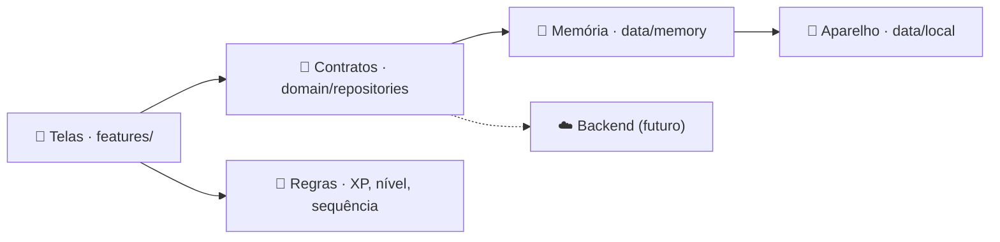

<div align="center">


<br><br>


# Gabaritei

**O aluno não só joga: ele domina o conteúdo.**<br>
Trilhas, desafios, XP e ranking para o ensino médio técnico e regular, com painel para o professor.

[](https://github.com/frahncky/Gabaritei/releases/latest)
[](https://flutter.dev)
[](https://dart.dev)
[](#-instalar-no-celular)
[](#-status)

[Sobre](#-sobre) ·
[Funcionalidades](#-funcionalidades) ·
[Gamificação](#-gamificação) ·
[Instalar](#-instalar-no-celular) ·
[Como executar](#-como-executar) ·
[Arquitetura](#-arquitetura)

</div>

---

## ✨ Sobre

O **Gabaritei** transforma o estudo em uma jornada: cada desafio, trilha e medalha leva o estudante da primeira faísca de curiosidade até o domínio da matéria. O projeto começa pelos **cursos técnicos** (Eletrotécnica, Eletrônica, Automação) e foi pensado para atender também o **ensino médio regular**.

O app funciona **sem servidor**: o progresso fica salvo no próprio aparelho, com conteúdo de exemplo pronto para explorar.

## 🧭 Funcionalidades

| | |
| --- | --- |
| 🏠 **Início do aluno** | Nível, XP, sequência, missões do dia e desafio relâmpago num só lugar. |
| 🛤️ **Trilhas** | Disciplinas em módulos que se desbloqueiam em ordem, com estrelas e prova final. |
| ⚡ **Desafios** | Quizzes cronometrados com combo por acertos seguidos, dica que custa XP e explicação a cada resposta. |
| 🧩 **Questões visuais** | Circuitos em série e paralelo, código de cores, plantas elétricas (sala e quarto) e controle de processo desenhados no app. |
| 🔬 **Laboratório** | Circuito animado com Lei de Ohm e potência, código de cores dos resistores e controle de nível com CLP. |
| 🏆 **Ranking da turma** | Semana, mês e geral, com ligas Cobre → Prata → Ouro. |
| 👤 **Perfil** | Estatísticas, calendário de estudo e coleção de medalhas. |
| 💾 **Progresso salvo** | XP, sequência, medalhas e missões continuam lá ao reabrir o app. |
| 🧑‍🏫 **Painel do professor** | Acerto por tópico, alunos que precisam de atenção, lembretes e criação de desafios. |

## 🎮 Gamificação

### 📈 Níveis

<div align="center">

| ✨ **Faísca** | 📘 **Aprendiz** | 🔪 **Afiado** | 🏅 **Craque** | 👑 **Domínio** |
| :---: | :---: | :---: | :---: | :---: |
| I · II · III | I · II · III | I · II · III | I · II · III | o topo |

</div>

### ⚡ Como se ganha XP

| Ação | XP |
| --- | :---: |
| Questão correta | +10 |
| Lição concluída | +30 a 40 |
| Missão diária | +30 a 80 |
| Desafio relâmpago | +80 + combo |
| Prova final de trilha | +300 |
| Usar dica | −10 |

<sub>Combo: a partir de 3 acertos seguidos, o XP do desafio dobra.</sub>

### 🏅 Medalhas

<div align="center">

| Ω **Mestre de Ohm** | ⚡ **Potência Total** | 🎨 **Olho de Resistor** | 🔀 **Rei do Paralelo** | 🔧 **Eletricista de Base** | 🔁 **Kirchhoff** |
| :---: | :---: | :---: | :---: | :---: | :---: |

| 🔥 **7 dias seguidos** | 🔥 **30 dias seguidos** | 🔥 **100 dias seguidos** |
| :---: | :---: | :---: |

</div>

Regras que mantêm o jogo justo:

- **Sequência de verdade.** Conta só dias com atividade concluída; perder um dia zera a sequência.
- **Missões diárias.** Renovam todo dia, sempre curtas.
- **Ligas semanais.** Os 3 primeiros da semana sobem no domingo, para o topo não ser sempre dos mesmos.

> 📘 Regras completas: **[docs/gamificacao.md](docs/gamificacao.md)**.

## 📲 Instalar no celular

Baixe o `app-release.apk` em **[Releases](https://github.com/frahncky/Gabaritei/releases/latest)** e abra no celular Android. O sistema vai pedir para permitir a instalação de fontes desconhecidas.

## 🚀 Como executar

**Pré-requisitos:** [Flutter](https://docs.flutter.dev/get-started/install) 3.27+ e um emulador ou aparelho Android.

```bash
git clone https://github.com/frahncky/Gabaritei.git
cd Gabaritei/app
flutter pub get
flutter run
```

<details>
<summary><b>Testes, análise e build</b></summary>

<br>

```bash
flutter analyze
flutter test
flutter build apk      # gera o APK em build/app/outputs/flutter-apk/
```

</details>

## 🧱 Arquitetura

As telas dependem só de contratos de repositório. Hoje eles são atendidos por dados em memória salvos no aparelho; um backend futuro entra trocando uma linha em `lib/app/dependencies.dart`.



| Pasta | Conteúdo |
| --- | --- |
| `app/lib/app` | Tema, injeção de dependências e raiz do app |
| `app/lib/domain` | Modelos, regras de XP, nível e sequência, gerador de questões e contratos |
| `app/lib/data` | Repositórios em memória, conteúdo de exemplo e persistência local |
| `app/lib/features` | Telas: início, trilhas, quiz, laboratório, ranking, perfil e professor |
| `app/lib/shared` | Marca, widgets e formatação reutilizáveis |
| `app/test` | Testes de tela, regras e persistência |
| `design/mockup` | Mockup das telas (referência visual) |
| `docs` | Regras de gamificação e imagens do README |

**Tecnologias:** Flutter · Dart · Material 3 · shared_preferences

<details>
<summary><b>🎨 Identidade visual</b></summary>

<br>

- **Símbolo:** a bolha do gabarito marcada, um círculo âmbar com ✓ sobre fundo escuro. Desenhado em código (`app/lib/shared/brand.dart`), gera o ícone e o splash.
- **Estilo "planta técnica":** fundo azul-marinho `#0F1D33` com grade fina e cartões `#1A2A45`.
- **Cores:** ação  · destaque  · XP e conquistas  
- **Tipografia:** Bricolage Grotesque (títulos e números) e IBM Plex Sans (texto), embutidas no app.

</details>

<details>
<summary><b>🖼️ Mockup</b></summary>

<br>

As telas estão em [`design/mockup/`](design/mockup/): início, trilhas, quiz, resultado, ranking, perfil e painel do professor. Os arquivos `.dc.html` são o código-fonte do canvas de design; servem de inspiração, e o app pode (e deve) ir além deles.

</details>

## 🚧 Status

Protótipo funcional em **desenvolvimento ativo**.

- [x] Mockup das telas do aluno e do painel do professor
- [x] Protótipo navegável: início, trilhas, desafio, resultado, ranking, perfil e professor
- [x] Laboratório de eletricidade e de automação
- [x] Progresso salvo no aparelho
- [ ] Backend com banco de questões e turmas reais
- [ ] Piloto com uma turma de Eletrotécnica

---

<div align="center">


**Gabaritei**<br>
*Estude. Jogue. Domine.*

<sub>Feito com ⚡ e Flutter por Francisco</sub>

</div>
