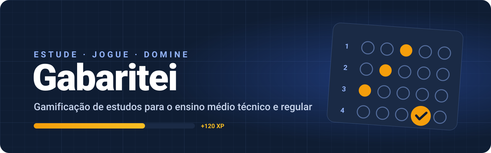

<div align="center">



<br>


# Gabaritei

**Estude. Jogue. Domine.**

Cursos técnicos, disciplinas e atividades com explicações, progresso e medalhas.

[](https://github.com/frahncky/Gabaritei/actions/workflows/flutter.yml)
[](https://github.com/frahncky/Gabaritei/releases/latest)
[](#-executar-e-instalar)
[](#-estado-do-projeto)

[📚 Cursos](#-cursos) ·
[🛤️ Como estudar](#-como-estudar) ·
[🏅 Medalhas](#-medalhas-e-progressão) ·
[📲 Instalar](#-executar-e-instalar) ·
[🗺️ Roadmap](docs/roadmap.md)

</div>

---

## ✨ O projeto

O **Gabaritei** organiza o estudo de conteúdos técnicos em trilhas com resumos, questões, explicações e provas finais. O aluno escolhe um curso, estuda suas disciplinas e acompanha a evolução no próprio aparelho.

O catálogo atual atende **Eletrotécnica, Eletrônica, Automação Industrial e Mecatrônica**. A expansão para o ensino médio regular permanece no planejamento.

| 🎓 Cursos | 📚 Disciplinas | 🧩 Unidades de estudo | ❓ Questões distintas |
| :---: | :---: | :---: | :---: |
| **4** | **26** | **86** | **464** |

**26 provas finais · 116 medalhas · progresso salvo localmente**

> O banco possui **354 questões de estudo e 110 exclusivas das provas finais**. Cada unidade tem pelo menos quatro questões. A revisão pedagógica por docentes e a ampliação com novos recursos visuais continuam previstas.

## 🎓 Cursos

| Curso | Disciplinas | Foco de estudo |
| --- | :---: | --- |
| ⚡ **Técnico em Eletrotécnica** | 13 | Circuitos CC e CA, máquinas, instalações, instrumentação e manutenção |
| 🔬 **Técnico em Eletrônica** | 16 | Eletrônica analógica e digital, sinais, medições e sistemas embarcados |
| ⚙️ **Técnico em Automação Industrial** | 17 | CLP, sensores, controle de processos, robótica e redes industriais |
| 🤖 **Técnico em Mecatrônica** | 23 | Mecânica, eletrônica, programação e manufatura integradas |

As disciplinas são compartilhadas entre os cursos: **26 é o total de disciplinas distintas**. Trocar de curso mantém o progresso da mesma disciplina.

Cada curso possui descrição, objetivo e seleção de disciplinas na tela **Cursos e disciplinas**, acessível pela aba **Trilhas**. Essa organização didática não representa matrícula, certificação ou equivalência a um PPC institucional.

📖 **[Ver as 26 disciplinas e suas unidades](docs/cursos.md)** · **[Banco de questões](docs/banco_questoes.md)**

## 🛤️ Como estudar

1. **Escolha o curso e a disciplina.** A lista mostra as disciplinas vinculadas ao curso selecionado.
2. **Abra “Estudar o conteúdo”.** Leia o resumo do módulo e inicie a atividade.
3. **Responda e aprenda.** Confira a explicação de cada resposta e avance com pelo menos **70% de acerto**.
4. **Conclua a trilha.** Passe pelos módulos e pela prova final para conquistar a medalha da disciplina.

A melhor nota de cada atividade fica salva. Uma tentativa pior não desfaz o avanço. A seleção de curso e disciplina é mantida ao alternar as abas durante a sessão.

**CLP e Automação** exige concluir **Eletrônica Digital**, incluindo a prova final.

## 🧭 Recursos atuais

| Recurso | O que está disponível |
| --- | --- |
| 🏠 **Início do aluno** | Nível, XP, sequência, missões de exemplo e desafio relâmpago |
| 📚 **Cursos e disciplinas** | Quatro cursos, 26 trilhas, resumos e atividades em todas as unidades de estudo |
| 🧩 **Questões e explicações** | 464 questões; 141 possuem figuras, gráficos ou tabelas específicos, cobrindo as 26 disciplinas |
| 🔬 **Laboratórios** | Circuitos, Lei de Ohm, potência, código de cores e controle de nível com CLP |
| 👤 **Perfil** | Estatísticas, calendário de estudo e medalhas agrupadas por disciplina |
| 💾 **Persistência local** | Notas, XP, sequência, medalhas, missões e questões criadas pelo professor |
| 🏆 **Ranking demonstrativo** | Filtros de semana, mês e geral, com participantes de exemplo |
| 🧑‍🏫 **Painel docente demonstrativo** | Indicadores e turmas de exemplo, criação de questões e simulação de desafios e lembretes |

O aluno inicial e os indicadores de turma também usam dados de demonstração. O app ainda não tem contas autenticadas, turmas reais nem sincronização entre aparelhos. Desafios e lembretes simulados no painel não são enviados a alunos reais.

## 🖼️ Questões com recursos visuais

**141 questões ilustradas, com cobertura das 26 disciplinas.** Os recursos são ligados ao ID e aos dados do exercício, com descrição acessível e valores consistentes com o enunciado.

| Conteúdo | Recursos |
| --- | --- |
| ⚡ Circuitos e eletrônica | Série, paralelo, associação mista, diodos, capacitores e faixas de resistores |
| 📈 Circuitos CA | Senoides, atraso de fase e componentes vetoriais de impedância e potência |
| 🔢 Digital e CLP | Tabelas-verdade com saídas em aberto, Ladder e gráficos de sinais e temporização |
| 🎛️ Instrumentação e processos | Curvas de escala, valores de referência e medição, malhas com realimentação |
| ⚙️ Mecânica, pneumática e CAD | Engrenagens, forças, alavancas, cilindros, braço robótico e desenhos de escala |
| 🌐 Demais disciplinas | Topologias, diagramas funcionais, tabelas de dados e comparações em barras |

As demais questões continuam textuais. As figuras são esquemas didáticos; quando há normalização ou valores apenas ilustrativos, isso é identificado na descrição.

📐 **[Tipos de figura, acessibilidade e validação](docs/questoes_visuais.md)**

## 🏅 Medalhas e progressão

Cada disciplina tem uma conquista **“Domínio em [disciplina]”**. São **26 medalhas de domínio**, **87 por assunto** e **três de constância**.

| Disciplina | Medalha de domínio |
| --- | --- |
| ⚡ Eletricidade Básica | Domínio em Eletricidade Básica |
| 📈 Circuitos CA | Domínio em Circuitos CA |
| 🔢 Eletrônica Digital | Domínio em Eletrônica Digital |
| ⚙️ CLP e Automação | Domínio em CLP e Automação |
| 🤖 Robótica | Domínio em Robótica |

Todas as 86 unidades de estudo têm uma medalha por assunto; o desafio independente de código de cores completa as 87 conquistas. Os nomes identificam a disciplina, como **Eletricidade Básica · Lei de Ohm** e **Eletrônica Analógica · Resistores**. As de **7, 30 e 100 dias** aparecem no grupo **Constância**.

| Conquista ou avanço | Regra |
| --- | --- |
| Próximo módulo | Pelo menos 70% no módulo anterior |
| Medalha de domínio | Pelo menos 70% em todos os módulos e na prova final, respeitando o pré-requisito |
| Medalha de assunto | Pelo menos 80% na atividade correspondente |
| Estrelas | 1 a partir de 70%; 2 a partir de 85%; 3 com 100% |

Medalhas já salvas mantêm seus identificadores. Notas anteriores de pelo menos 80% reconhecem automaticamente as novas conquistas por assunto, sem exigir repetir a atividade nem alterar XP. O número mínimo de acertos depende do tamanho da atividade; com quatro questões, são necessários quatro acertos para atingir pelo menos 80%. Repetir uma atividade não concede novamente a mesma medalha. **Recomeçar progresso** zera também as notas das trilhas.

### ⚡ XP e níveis

| Ação | Pontuação |
| --- | --- |
| Resposta correta | +10 XP |
| Acerto em combo, a partir do terceiro consecutivo | +10 XP adicionais por acerto |
| Bônus de atividade | Valor configurado no quiz; no catálogo, 30 a 80 XP |
| Bônus de prova final | 300 XP |
| Usar dica | −10 XP |

O bônus de conclusão do quiz exige pelo menos 50% de acerto. Ele é separado do limite de **70% para avançar na trilha**.

Os níveis seguem a sequência **Faísca → Aprendiz → Afiado → Craque → Domínio**. Os quatro primeiros possuem três subníveis.

🏅 **[Ver todas as 87 conquistas por assunto](docs/medalhas.md)**

📘 **[Progressão das disciplinas](docs/disciplinas.md)** · **[Regras de gamificação](docs/gamificacao.md)**

## 📲 Executar e instalar

### Código atual da main

Requer **Flutter 3.27+**, Dart compatível e emulador ou aparelho Android. Use uma versão estável compatível com as dependências do projeto.

```bash
git clone https://github.com/frahncky/Gabaritei.git
cd Gabaritei/app
flutter pub get
flutter run
```

Para atualizar uma cópia existente, execute `git pull origin main` na pasta do repositório e depois `flutter pub get` dentro de `app`.

### APK publicado

O APK disponível em **[Releases](https://github.com/frahncky/Gabaritei/releases/latest)** é o da **v0.3.0, publicada em 20/10/2026**. Essa publicação é anterior às atualizações de cursos, disciplinas, progresso e medalhas descritas neste README.

Para testar o código atual, execute a `main` ou gere um APK:

```bash
cd app
flutter pub get
flutter build apk --release
```

O arquivo será gerado em `app/build/app/outputs/flutter-apk/app-release.apk`, considerando a raiz do repositório. Transfira-o ao aparelho e autorize a instalação pela origem utilizada.

## 🧪 Qualidade e testes

A ampliação do banco de questões passou por **`flutter analyze` sem apontamentos e 99 testes aprovados**, em 30/10/2026. **[Ver execução validada](https://github.com/frahncky/Gabaritei/actions/runs/41092867489)**.

A suíte cobre catálogo e vínculos dos cursos, questões e gabaritos, separação entre estudo e provas, cálculos representativos, progressão, medalhas, reconhecimento de notas antigas, persistência, reset e navegação. O workflow acompanha análise e testes na `main` e nos pull requests.

```bash
cd app
flutter analyze
flutter test
```

Essa validação não equivale a build Android ou teste manual em aparelho da entrega mais recente.

## 🧱 Organização do código

| Caminho | Responsabilidade |
| --- | --- |
| [app/lib/domain](app/lib/domain) | Modelos, regras de progressão, catálogo de cursos e contratos |
| [app/lib/data/memory](app/lib/data/memory) | Conteúdo didático e repositórios locais com dados demonstrativos |
| [app/lib/data/local](app/lib/data/local) | Persistência no aparelho com `shared_preferences` |
| [app/lib/features](app/lib/features) | Início, cursos e disciplinas, quiz, laboratórios, ranking, perfil e professor |
| [app/lib/shared](app/lib/shared) | Marca, medalhas, formatação e componentes visuais |
| [app/test](app/test) | Testes de regras, catálogo, persistência e interface |
| [docs](docs) | Cursos, disciplinas, gamificação e roadmap |
| [design/mockup](design/mockup) | Referências visuais do projeto |

As dependências ficam centralizadas em [app/lib/app/dependencies.dart](app/lib/app/dependencies.dart). Um backend futuro precisa implementar os contratos, a autenticação, as permissões e a sincronização.

<details>
<summary>🎨 Identidade visual</summary>

- **Marca:** círculo âmbar com a bolha do gabarito marcada.
- **Estilo:** fundo azul-marinho, grade técnica e cartões com contraste.
- **Cores:** azul para ações, âmbar para XP e conquistas.
- **Tipografia:** Bricolage Grotesque e IBM Plex Sans, embutidas no aplicativo.

Os arquivos em `design/mockup` são referências de design, não capturas das telas atuais.

</details>

## 🚧 Estado do projeto

**Protótipo local em desenvolvimento ativo.** O catálogo e a progressão funcionam no aparelho; a plataforma com turmas reais é a próxima frente.

- [x] Quatro cursos com disciplinas vinculadas
- [x] 26 disciplinas, 86 unidades de estudo e 464 questões distintas
- [x] Resumos, atividades e 26 provas finais
- [x] Figuras, gráficos e tabelas específicos em questões das 26 disciplinas
- [x] 87 medalhas por assunto, 26 de domínio e três de constância
- [x] Reconhecimento de notas antigas e progresso salvo
- [x] Laboratórios de eletricidade e automação
- [x] Análise e testes automatizados
- [ ] Ampliar o conteúdo e concluir revisão pedagógica
- [ ] Validar build e uso em aparelho para a entrega atual
- [ ] Publicar um APK com as atualizações da main
- [ ] Implementar contas, backend e turmas reais
- [ ] Sincronizar progresso entre aparelhos
- [ ] Conectar ranking e painel docente a dados reais
- [ ] Realizar piloto com uma turma de Eletrotécnica

🗺️ **[Roadmap completo](docs/roadmap.md)** — prioridades, dependências e critérios de conclusão.

---

<div align="center">


**Gabaritei**  
*Estude. Jogue. Domine.*

<sub>Feito com ⚡ e Flutter por Francisco</sub>

</div>
